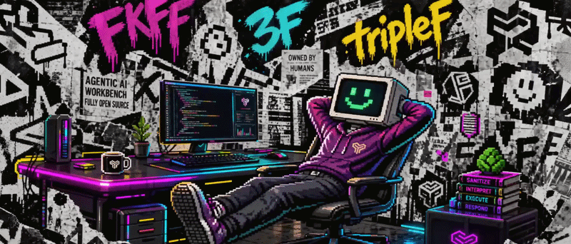

<div align="center">



<br>

**An agentic AI workbench, fully open source.**     
Chat with free open models — running **fully locally** via Ollama, or on **Ollama Cloud** for extra headroom.    
No lock-in, no meter, no black box — the whole machine is inspectable, and yours.    
Early in development; already a complete chat experience with features some proprietary chats still miss.    
tripleF aims for the top of the open-source community.   


<br>
<br>


[](https://about.codecov.io/)

<br>
</div>

<div align="center">

### Built with AI-Assisted Context Coding, Owned by Humans

This project is developed using **context coding** — a disciplined [AI-assisted](.wiki/3-ai-assisted-development.md) paradigm    
where generative tools accelerate boilerplate and exploration while every architectural decision,    
interface contract, and failure mode is deliberately reviewed, tested, and owned.       
We believe velocity without ownership accelerates directly into technical insolvency.

<br>

## Kickoff

<div align="left">

1. [Install Docker/Docker Compose](https://docs.docker.com/compose/install/)
2. [Clone Repository](https://github.com/ehildt/tripleF)
3. Create API keys (optional but recommended):
   - **Ollama API key** — for cloud models. Create one at [ollama.com/settings/keys](https://ollama.com/settings/keys) · [auth docs](https://docs.ollama.com/api/authentication)
   - **YouTube Data API key** (free) — enable the API in the Google Cloud Console, then create a key under Credentials. [Getting started](https://developers.google.com/youtube/v3/getting-started) · [obtaining credentials](https://developers.google.com/youtube/registering_an_application)
   - **Serper API key** — [sign up](https://serper.dev/signup) and copy the key from the dashboard (2,500 free credits; afterwards super cheap — ~€5 yields 5k searches that will almost last you a lifetime)
   - **Bright Data API key + SERP zone** — enterprise-grade alternative to Serper, slightly more expensive. [API key docs](https://docs.brightdata.com/api-reference/authentication) · [SERP API quickstart](https://docs.brightdata.com/scraping-automation/serp-api/quickstart)
   - **EODHD API key** — financial data API, free tier + tiered subscriptions. [Register](https://eodhd.com/register) and grab the token from the dashboard · [quick start](https://eodhd.com/financial-apis/quick-start-with-our-financial-data-apis)
4. Create the env files from the examples:

   ```bash
   cp apps/server/.env.example apps/server/.env
   cp apps/memory/.env.example apps/memory/.env
   cp apps/dashboard/.env.example apps/dashboard/.env
   ```

   Set optional provider keys in `apps/server/.env` (`OLLAMA_API_KEY`, `YOUTUBE_API_KEY`, `SERPER_API_KEY`, `BRIGHT_DATA_API_KEY` + zones, `EODHD_API_KEY`). Set `OLLAMA_API_KEY` in `apps/memory/.env` too when using Ollama Cloud. `QDRANT_EMBED_MODEL` defaults to `nomic-embed-text-v2-moe`.
5. Memory auto-maintenance (optional but recommended) — enable the `*_AUTO` flags in `./apps/memory/.env`:
   - `MEMORY_PARTITION_REFLECT_AUTO=true` — auto-trigger reflection after a partition's consolidation sweep
   - `MEMORY_COGNITION_REFLECT_AUTO=true` — auto-trigger reflection after a cognition profile job
   - `MEMORY_ENCYCLOPEDIA_REFLECT_AUTO=true` — auto-trigger reflection after the encyclopedia classification job
   - and downstream: `MEMORY_CONVICTION_AUTO=true`, `MEMORY_CLUSTER_AUTO=true`

   Otherwise reflection never runs on its own — you would need to trigger it manually via a cron job or scheduler hitting `POST /memory/reflect`, `POST /memory/cognition/reflect`, or `POST /encyclopedia/reflect`. All of these can also be toggled live in Settings (settings → memory → configuration) without a restart.
6. Install dependencies from the repository root:

   ```bash
   pnpm install
   ```

7. Start the backing services and wait until their healthchecks pass:

   ```bash
   docker compose -f infra.compose.yml up -d --wait
   ```

8. Push the server-owned Prisma schema to PostgreSQL:

   ```bash
   pnpm --filter @triplef/server db:push
   ```

9. Start the server, memory app, and dashboard:

   ```bash
   docker compose up -d
   ```

For local inference, make sure Ollama is reachable from the containers at `http://host.docker.internal:11434/api` and pull both your chat model and `nomic-embed-text-v2-moe`. For Ollama Cloud, set `OLLAMA_HOST=https://ollama.com/api` and `OLLAMA_API_KEY` in both server and memory env files instead.

Open **http://localhost:5173/dashboard/**. The server API is at `http://localhost:3000/api/v1`, Swagger is at `http://localhost:3000/api-docs`, and the RustFS console is at `http://localhost:9001` with the development credentials `triplef` / `triplef`.

</div>

<br>

## Contributing & Community

Contributions are welcome! Please read [CONTRIBUTING.md](CONTRIBUTING.md) before opening an issue or pull request.    
Found a vulnerability? See [SECURITY.md](SECURITY.md) for our reporting policy.    
Community guidelines are in [CODE_OF_CONDUCT.md](CODE_OF_CONDUCT.md).    
Distributed under the MIT License. See [LICENSE](LICENSE) for more information.

</div>

<br>

<div align="center">

[E-MAIL](mailto:eugen.hildt@gmail.com) · [WIKI](https://github.com/ehildt/tripleF/wiki) · [ISSUES](https://github.com/ehildt/tripleF/issues) · [DONATE](https://github.com/sponsors/ehildt)

</div>
